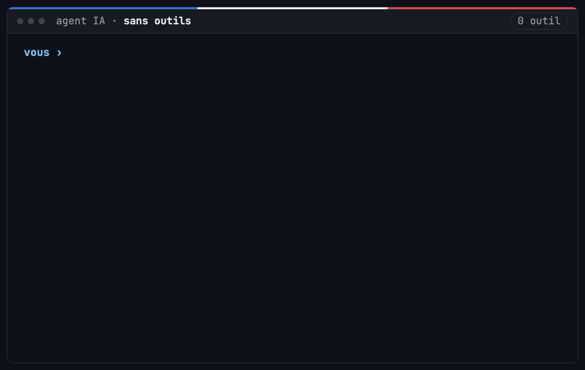

<div align="center">

# france-mcp

### L'État français, branché sur l'IA.

**19 outils · 12 sources officielles · zéro clé API · une ligne d'installation.**<br>
<sub>+ Légifrance en option avec une clé PISTE gratuite</sub>

Sirene, BOAMP, DVF, cadastre, Base Adresse Nationale, Géorisques, DPE, Caparéseau, data.gouv.fr, Service-Public.fr, Légifrance…<br>
Votre agent IA (Claude, Cursor, VS Code, n'importe quel client MCP) interroge directement les données publiques et **cite ses sources**.

[](https://github.com/tbsrgt/france-mcp/actions/workflows/ci.yml)
[](#-fidélité--2-400-vérifications-contre-la-source)
[](https://modelcontextprotocol.io)
[](LICENSE)




</div>

---

## Une question, l'État répond

> **« Je veux poser du solaire sur un hangar près de Rousset. Y a-t-il de la capacité réseau à côté ? »**
> → `adresse_geocoder` → `energie_postes_sources` : poste de Rousset à 1,8 km du centre, 13,9 MW encore à affecter, quote-part 78,47 k€/MW.

> **« Ce fournisseur est-il solide ? »**
> → `entreprises_fiche` : SIREN, dirigeants, chiffre d'affaires publié, labels RGE/Qualiopi, état administratif.

> **« Quels appels d'offres photovoltaïque sont encore ouverts dans les Bouches-du-Rhône ? »**
> → `marches_rechercher` : avis du BOAMP, acheteur, date limite, lien direct.

> **« Prix au m² des appartements à Bordeaux depuis 2023 ? Risques à cette adresse ? Passoires thermiques dans la rue ? »**
> → `dvf_statistiques` · `risques_adresse` · `dpe_rechercher`

Chaque réponse contient un champ `source` (nom officiel et URL). L'agent cite la source au lieu d'inventer.

## Installation

Rien à configurer, aucune clé à demander. Il faut juste Node.js 20 ou plus.

<details open>
<summary><b>Claude Code</b></summary>

```bash
claude mcp add france -- npx -y github:tbsrgt/france-mcp
```
</details>

<details>
<summary><b>Claude Desktop</b></summary>

Dans `claude_desktop_config.json` (Réglages → Développeur → Modifier la configuration) :

```json
{
  "mcpServers": {
    "france": {
      "command": "npx",
      "args": ["-y", "github:tbsrgt/france-mcp"]
    }
  }
}
```
</details>

<details>
<summary><b>Cursor</b></summary>

Dans `~/.cursor/mcp.json` :

```json
{
  "mcpServers": {
    "france": { "command": "npx", "args": ["-y", "github:tbsrgt/france-mcp"] }
  }
}
```
</details>

<details>
<summary><b>VS Code (Copilot)</b></summary>

```bash
code --add-mcp '{"name":"france","command":"npx","args":["-y","github:tbsrgt/france-mcp"]}'
```
</details>

<details>
<summary><b>Depuis les sources</b></summary>

```bash
git clone https://github.com/tbsrgt/france-mcp && cd france-mcp && npm install
node src/index.js --list     # liste les outils
npm run smoke                # appelle chaque outil sur les vraies API
```
</details>

## Les 19 outils

| Domaine | Outil | Ce qu'il fait | Source officielle |
|---|---|---|---|
| **Entreprises** | `entreprises_rechercher` | Recherche par nom, SIREN, dirigeant, code postal, code NAF | INSEE Sirene · INPI RNE |
| | `entreprises_fiche` | Fiche complète : dirigeants, CA publié, TVA, labels RGE/ESS/Qualiopi, conventions collectives | Annuaire des Entreprises |
| **Territoires** | `adresse_geocoder` | Adresse vers GPS et code INSEE, tolère les fautes de frappe | Base Adresse Nationale (IGN) |
| | `adresse_inverse` | Point GPS vers adresse postale | Base Adresse Nationale |
| | `communes_rechercher` | Commune par nom, code postal ou GPS : population, EPCI, département | API Géo (INSEE) |
| | `territoire_lister` | Régions, départements, communes d'un département | API Géo |
| **Immobilier** | `cadastre_parcelle` | Parcelle à partir d'un point ou section/numéro : surface, contour GeoJSON | IGN API Carto |
| | `dvf_ventes` | Toutes les ventes réelles d'une commune depuis 2021 : prix, surface, prix/m², parcelle | DVF (DGFiP) |
| | `dvf_statistiques` | Prix médian au m², maisons et appartements, année par année | DVF (DGFiP) |
| **Bâtiment** | `risques_adresse` | Inondation, argiles, séisme, radon, sites industriels, sols pollués… | Géorisques |
| | `dpe_rechercher` | Étiquettes énergie et climat autour d'un point, filtre passoires F/G | ADEME (16 M de DPE) |
| **Marchés publics** | `marches_rechercher` | Appels d'offres, attributions, titulaires, marchés encore ouverts | BOAMP (DILA) |
| | `marches_avis` | Contenu complet d'un avis : lots, critères, contacts, modalités | BOAMP |
| **Énergie** | `energie_postes_sources` | Capacité de raccordement EnR des postes sources proches (MW, file d'attente, quote-part) | Caparéseau (RTE, Enedis, ELD) |
| **Open data** | `datagouv_rechercher` | Cherche parmi les jeux de données de data.gouv.fr | data.gouv.fr |
| | `datagouv_jeu_de_donnees` | Fichiers d'un jeu de données, formats, URL | data.gouv.fr |
| | `datagouv_apercu` | Lit et filtre les lignes d'un CSV public sans le télécharger | API tabulaire data.gouv |
| **Services publics** | `services_publics_trouver` | Mairie, préfecture, CAF, France Travail, tribunal… : adresse, téléphone, horaires | Service-Public.fr |
| | `jours_feries` | Jours fériés par année et par zone (métropole, Alsace-Moselle, outre-mer) | calendrier.api.gouv.fr |
| **Droit** *(option)* | `legifrance_rechercher` · `legifrance_article` | Codes, lois, JO, jurisprudence, conventions collectives | Légifrance (clé PISTE gratuite) |

Les outils se combinent. Par exemple, `adresse_geocoder` donne la latitude, la longitude et le code INSEE. On les passe ensuite au cadastre, à DVF, à Géorisques, aux DPE, à Caparéseau et à l'annuaire des services publics.

## ✅ Fidélité : 2 400 vérifications contre la source

Un connecteur qui déforme les données est pire que pas de connecteur. Pour le vérifier, `npm run parity` tire un échantillon déterministe (graine fixe) et compare chaque réponse **champ par champ** à un appel direct et indépendant de l'API officielle. L'outil est appelé à travers un vrai client MCP.

<!-- parity:start -->
| Échantillon | Source comparée | Identiques | Champs vérifiés |
|---|---|---|---|
| Communes | API Géo | 600 / 600 | nom, codes postaux, population, département, région, EPCI, SIREN |
| Entreprises | Annuaire des Entreprises | 600 / 600 | SIREN, nom, état, NAF, forme juridique, date de création, SIRET, code postal et commune du siège |
| Avis de marchés | BOAMP | 600 / 600 | objet, acheteur, nature, dates de parution et limite, départements, URL |
| Parcelles | IGN API Carto | 600 / 600 | identifiant, commune, section, numéro, surface |
| **Total** | | **2 400 / 2 400** | 18 600 champs comparés le 2026-11-15 |
<!-- parity:end -->

Résultat brut : [`test/parity-result.json`](test/parity-result.json). Relancez-le vous-même : `npm run parity` (environ 10 minutes). Pour un essai rapide : `PARITY_N=50 npm run parity`.

## Choisir ses outils

Tout est actif par défaut. Pour alléger le contexte de l'agent, gardez seulement les groupes utiles :

```bash
npx -y github:tbsrgt/france-mcp --toolsets entreprises,marches
# ou : FRANCE_MCP_TOOLSETS=immobilier,batiment,territoires
```

Groupes disponibles : `entreprises`, `territoires`, `immobilier`, `batiment`, `marches`, `datagouv`, `energie`, `services`, `legifrance`.

### Activer Légifrance

Légifrance passe par la plateforme PISTE de l'État. La clé est gratuite :

1. Créez un compte sur [piste.gouv.fr](https://piste.gouv.fr), puis une application.
2. Abonnez l'application à l'API **Légifrance** et acceptez les CGU.
3. Passez les identifiants au serveur :

```bash
claude mcp add france -e PISTE_CLIENT_ID=xxx -e PISTE_CLIENT_SECRET=yyy -- npx -y github:tbsrgt/france-mcp
```

> Le toolset Légifrance est en **bêta**. Contrairement aux autres sources, il ne fait pas partie des tests automatiques, faute de clé publique pour la CI.

## Principes

- **Lecture seule.** Aucun outil n'écrit nulle part. Tous sont annotés `readOnlyHint`.
- **Sources officielles uniquement**, appelées en direct, sans base intermédiaire ni scraping de sites tiers. Exception documentée : Caparéseau ne publie pas d'API. On lit donc les fichiers JSON que son site met à disposition.
- **Chaque réponse cite sa source.** Le serveur demande à l'agent de la mentionner.
- **Données personnelles minimisées.** Les dirigeants sont publics (RNE), mais leur date de naissance n'est jamais renvoyée.
- **Respect des API publiques** : cache de 5 minutes, nouvelles tentatives espacées sur les erreurs 429 et 5xx, `User-Agent` identifiable.
- **Zéro dépendance lourde** : le SDK MCP officiel et `zod`, rien d'autre. Pas d'étape de compilation.

## Feuille de route

Les contributions sont les bienvenues : chaque source tient dans un fichier de `src/tools/`.

- [ ] DECP : données essentielles de la commande publique (montants attribués)
- [ ] Comptes annuels déposés à l'INPI
- [ ] Hub'Eau : qualité de l'eau du robinet, nappes
- [ ] Bornes de recharge (IRVE) et prix des carburants en temps réel
- [ ] Météo-France et Vigilance
- [ ] PLU via le Géoportail de l'urbanisme
- [ ] Transport HTTP (Streamable HTTP) pour les clients distants

## Contribuer

```bash
npm install
npm test          # tests hors ligne
npm run smoke     # chaque outil contre les vraies API (≈ 15 s)
npm run parity    # vérification de fidélité
```

Pour ajouter une source, créez `src/tools/ma-source.js`, qui exporte `tools = [{ name, title, description, input, run }]`. Déclarez-la ensuite dans `src/registry.js` et ajoutez un cas dans `test/smoke.mjs`.

---

<details>
<summary><b>🇬🇧 English</b></summary>

**france-mcp** is an MCP server that gives any AI agent clean, read-only access to official French public data: company registry (Sirene/RNE), public procurement (BOAMP), real-estate transactions (DVF), land registry (cadastre), national address base, natural and industrial risks (Géorisques), energy performance certificates (ADEME), grid connection capacity for renewables (Caparéseau), data.gouv.fr, the public services directory, public holidays and, optionally, Légifrance (French law).

19 tools, no API key, one-line install: `claude mcp add france -- npx -y github:tbsrgt/france-mcp`. Every response carries its official `source`. Fidelity is checked by comparing tool outputs field by field against direct calls to the official APIs (`npm run parity`). Tool names and outputs are in French, like the data.
</details>

## Licence

Code sous licence [MIT](LICENSE). Les données restent celles de leurs producteurs : la plupart sont publiées sous [Licence Ouverte Etalab 2.0](https://www.etalab.gouv.fr/licence-ouverte-open-licence/). Citez la source indiquée dans chaque réponse.

Projet indépendant, sans lien avec l'administration française.
